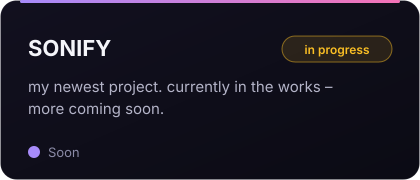

  
  

hey, i'm **verity** – a developer from germany. right now i'm working on **sonify** – more about it soon. i like building things from scratch and keeping them fast and simple.

## currently building

## stack

## activity

---

most of my work happens in <a href="https://github.com/Verityzs?tab=repositories">my repos</a> – feel free to look around.
